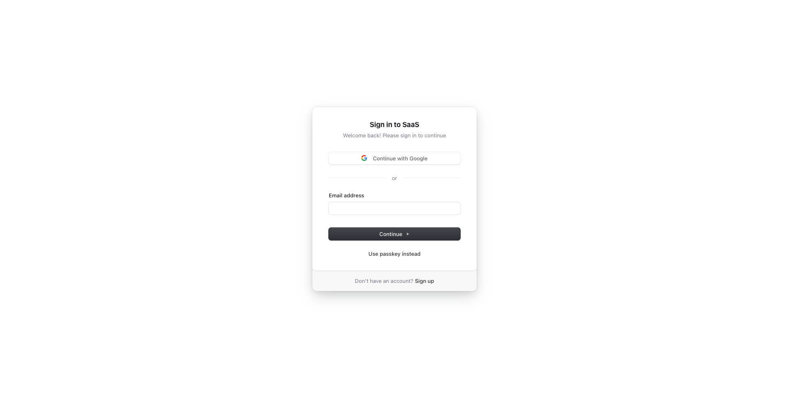

# Code-huddle | Boilerplate and Starter for Next.js 15+, Tailwind CSS 3.4, and TypeScript.

🚀 Boilerplate and Starter for Next.js with App Router, Tailwind CSS, and TypeScript ⚡️ Prioritizing developer experience first: Next.js, TypeScript, ESLint, Prettier, Husky, Lint-Staged, Vitest (replacing Jest), Testing Library, Playwright, Commitlint, VSCode, Tailwind CSS, Logging with Pino.js and Log Management, Monitoring as Code, Storybook, Multi-language (i18n), and more.

Clone this project and use it to create your own Next.js project.

### Demo

| Sign Up | Sign In |
| --- | --- |
| [](https://demo.nextjs-boilerplate.com/sign-up) | [](https://demo.nextjs-boilerplate.com/sign-in) |

### Features

Developer experience first, extremely flexible code structure and only keep what you need:

- ⚡ [Next.js](https://nextjs.org) with App Router support
- 🔥 Type checking [TypeScript](https://www.typescriptlang.org)
- 💎 Integrate with [Tailwind CSS](https://tailwindcss.com)
- ✅ Strict Mode for TypeScript and React 19
- 👤 Passwordless Authentication with, Social Auth (Google , GitHub), Passwordless login with Passkeys, User Impersonation
- 💽 Offline and local development database with PGlite
- 🌐 Multi-language (i18n) with [next-intl](https://next-intl-docs.vercel.app/) and [Crowdin](https://l.crowdin.com/next-js)
- ♻️ Type-safe environment variables with T3 Env
- ⌨️ Form handling with React Hook Form
- 🔴 Validation library with Zod
- 📏 Linter with [ESLint](https://eslint.org) (default Next.js, Next.js Core Web Vitals, Tailwind CSS and Antfu configuration)
- 💖 Code Formatter with [Prettier](https://prettier.io)
- 🦊 Husky for Git Hooks
- 🚫 Lint-staged for running linters on Git staged files
- 🚓 Lint git commit with Commitlint
- 📓 Write standard compliant commit messages with Commitizen
- 🦺 Unit Testing with Vitest and React Testing Library
- 🧪 Integration and E2E Testing with Playwright
- 👷 Run tests on pull request with GitHub Actions
- 🎉 Storybook for UI development
- ☂️ Code coverage with [Codecov](https://about.codecov.io/codecov-free-trial/?utm_source=github&utm_medium=paid-community&utm_campaign=general-fy25q1-nextjs&utm_content=github-banner-nextjsboilerplate-logo)
- 📝 Logging with Pino.js and Log Management with [Better Stack](https://betterstack.com/?utm_source=github&utm_medium=sponsorship&utm_campaign=next-js-boilerplate)
- 🎁 Automatic changelog generation with Semantic Release
- 🔍 Visual testing with Percy (Optional)
- 💡 Absolute Imports using `@` prefix
- 🗂 VSCode configuration: Debug, Settings, Tasks and Extensions
- 🤖 SEO metadata, JSON-LD and Open Graph tags
- 🗺️ Sitemap.xml and robots.txt
- ⌘ Database exploration with Drizzle Studio and CLI migration tool with Drizzle Kit
- ⚙️ [Bundler Analyzer](https://www.npmjs.com/package/@next/bundle-analyzer)
- 🌈 Include a FREE minimalist theme
- 💯 Maximize lighthouse score

Built-in feature from Next.js:

- ☕ Minify HTML & CSS
- 💨 Live reload
- ✅ Cache busting

### Philosophy

- Nothing is hidden from you, allowing you to make any necessary adjustments to suit your requirements and preferences.
- Dependencies are regularly updated on a monthly basis
- Start for free without upfront costs
- Easy to customize
- Minimal code
- Unstyled template
- SEO-friendly
- 🚀 Production-ready

### Requirements

- Node.js 20+ and npm

### Getting started

Run the following command on your local environment:

```shell
git clone --depth=1 https://github.com/Code-Huddle/nextjs-boilerplate-latest.git
cd my-project-name
npm install
```

For your information, all dependencies are updated every month.

Then, you can run the project locally in development mode with live reload by executing:

```shell
npm run dev
```

Open http://localhost:3000 with your favorite browser to see your project.

### Docker

To build and run the app in production mode with Docker:

```bash
docker build -t nextjs-boilerplate .
docker run -p 3000:3000 nextjs-boilerplate
```

For local development with hot reload, use Docker Compose:

```bash
docker compose up
```

Make sure to create a `.env` file based on `.env.example` before starting the containers.

### Set up authentication

Authentication is modular and can be configured during project creation. Choose between NextAuth, Supabase, or None when running the CLI.

### Translation (i18n) setup

For translation, the project uses `next-intl` combined with [Crowdin](https://l.crowdin.com/next-js). As a developer, you only need to take care of the English (or another default language) version. Translations for other languages are automatically generated and handled by Crowdin. You can use Crowdin to collaborate with your translation team or translate the messages yourself with the help of machine translation.

To set up translation (i18n), create an account at [Crowdin.com](https://l.crowdin.com/next-js) and create a new project. In the newly created project, you will be able to find the project ID. You will also need to create a new Personal Access Token by going to Account Settings > API. Then, in your GitHub Actions, you need to define the following environment variables: `CROWDIN_PROJECT_ID` and `CROWDIN_PERSONAL_TOKEN`.

After defining the environment variables in your GitHub Actions, your localization files will be synchronized with Crowdin every time you push a new commit to the `main` branch.

### Project structure

```shell
.
├── README.md                       # README file
├── .github                         # GitHub folder
├── .husky                          # Husky configuration
├── .storybook                      # Storybook folder
├── .vscode                         # VSCode configuration
├── migrations                      # Database migrations
├── public                          # Public assets folder
├── src
│   ├── app                         # Next JS App (App Router)
│   ├── components                  # React components
│   ├── libs                        # 3rd party libraries configuration
│   ├── locales                     # Locales folder (i18n messages)
│   ├── models                      # Database models
│   ├── styles                      # Styles folder
│   ├── templates                   # Templates folder
│   ├── types                       # Type definitions
│   ├── utils                       # Utilities folder
│   └── validations                 # Validation schemas
├── tests
│   ├── e2e                         # E2E tests, also includes Monitoring as Code
│   └── integration                 # Integration tests
├── tailwind.config.js              # Tailwind CSS configuration
└── tsconfig.json                   # TypeScript configuration
```

### Customization

You can easily configure Next js Boilerplate by searching the entire project for `FIXME:` to make quick customizations. Here are some of the most important files to customize:

- `public/apple-touch-icon.png`, `public/favicon.ico`, `public/favicon-16x16.png` and `public/favicon-32x32.png`: your website favicon
- `src/utils/AppConfig.ts`: configuration file
- `src/templates/BaseTemplate.tsx`: default theme
- `next.config.mjs`: Next.js configuration
- `.env`: default environment variables

You have full access to the source code for further customization. The provided code is just an example to help you start your project. The sky's the limit 🚀.

### Data fetching with React Query

This project uses [TanStack Query](https://tanstack.com/query/latest) for data fetching and caching. The `QueryClient` is initialized in [`src/libs/queryClient.ts`](src/libs/queryClient.ts) and provided to the app in [`src/app/[locale]/layout.tsx`](src/app/%5Blocale%5D/layout.tsx).

```tsx
// src/libs/queryClient.ts
'use client';
import { HydrationBoundary, QueryClient, QueryClientProvider } from '@tanstack/react-query';
import { useState } from 'react';

export function QueryClientProvider({ children, dehydratedState }) {
  const [queryClient] = useState(() => new QueryClient());
  return (
    <QueryClientProvider client={queryClient}>
      {dehydratedState ? <HydrationBoundary state={dehydratedState}>{children}</HydrationBoundary> : children}
    </QueryClientProvider>
  );
}
```

Use `useQuery` in client components to replace manual `fetch` calls:

```tsx
import { useQuery } from '@tanstack/react-query';

function RandomJoke() {
  const { data } = useQuery({ queryKey: ['joke'], queryFn: fetchJoke });
  return <div>{data?.value}</div>;
}
```

For server-side rendering, you can pass an optional `dehydratedState` prop to hydrate pre-fetched queries.

### Commit Message Format

The project follows the [Conventional Commits](https://www.conventionalcommits.org/) specification, meaning all commit messages must be formatted accordingly. To help you write commit messages, the project uses [Commitizen](https://github.com/commitizen/cz-cli), an interactive CLI that guides you through the commit process. To use it, run the following command:

```shell
npm run commit
```

One of the benefits of using Conventional Commits is the ability to automatically generate a `CHANGELOG` file. It also allows us to automatically determine the next version number based on the types of commits that are included in a release.

### Testing

All unit tests are located alongside the source code in the same directory, making them easier to find. The project uses Vitest and React Testing Library for unit testing. You can run the tests with the following command:

```shell
npm run test
```

### Integration & E2E Testing

The project uses Playwright for integration and end-to-end (E2E) testing. You can run the tests with the following commands:

```shell
npx playwright install # Only for the first time in a new environment
npm run test:e2e
```

In the local environment, visual testing is disabled, and the terminal will display the message `[percy] Percy is not running, disabling snapshots.`. By default, visual testing only runs in GitHub Actions.

### Enable Edge runtime (optional)

The App Router folder is compatible with the Edge runtime. You can enable it by adding the following lines `src/app/layouts.tsx`:

```tsx
export const runtime = 'edge';
```

```tsx
await migrate(db, { migrationsFolder: './migrations' });
```

After disabling it, you are required to run the migration manually with:

```shell
npm run db:migrate
```

You also require to run the command each time you want to update the database schema(THIS IS ONLY APPLICABLE IF YOU WANT TO INTEGRATE CLOUD SERVICE LIKE SUPABASE ETC).

### Deploy to production

During the build process, database migrations are automatically executed, so there's no need to run them manually. However, you must define `DATABASE_URL` in your environment variables.

Then, you can generate a production build with:

```shell
$ npm run build
```

It generates an optimized production build of the boilerplate. To test the generated build, run:

```shell
$ npm run start
```

This command starts a local server using the production build. You can now open http://localhost:3000 in your preferred browser to see the result.

### Code coverage

Next.js Boilerplate relies on [Codecov](https://about.codecov.io/codecov-free-trial/?utm_source=github&utm_medium=paid-community&utm_campaign=general-fy25q1-nextjs&utm_content=github-banner-nextjsboilerplate-logo) for code coverage reporting solution. To enable Codecov, create a Codecov account and connect it to your GitHub account. Your repositories should appear on your Codecov dashboard. Select the desired repository and copy the token. In GitHub Actions, define the `CODECOV_TOKEN` environment variable and paste the token.

Make sure to create `CODECOV_TOKEN` as a GitHub Actions secret, do not paste it directly into your source code.

### Logging

The project uses Pino.js for logging. In the development environment, logs are displayed in the console by default.

For production, the project is already integrated with [Better Stack](https://betterstack.com/?utm_source=github&utm_medium=sponsorship&utm_campaign=next-js-boilerplate) to manage and query your logs using SQL. To use Better Stack, you need to create a [Better Stack](https://betterstack.com/?utm_source=github&utm_medium=sponsorship&utm_campaign=next-js-boilerplate) account and create a new source: go to your Better Stack Logs Dashboard > Sources > Connect source. Then, you need to give a name to your source and select Node.js as the platform.

After creating the source, you will be able to view and copy your source token. In your environment variables, paste the token into the `LOGTAIL_SOURCE_TOKEN` variable. Now, all logs will automatically be sent to and ingested by Better Stack.


### Useful commands

#### Bundle Analyzer

Next.js Boilerplate includes a built-in bundle analyzer. It can be used to analyze the size of your JavaScript bundles. To begin, run the following command:

```shell
npm run build-stats
```

By running the command, it'll automatically open a new browser window with the results.

### VSCode information (optional)

If you are VSCode user, you can have a better integration with VSCode by installing the suggested extension in `.vscode/extension.json`. The starter code comes up with Settings for a seamless integration with VSCode. The Debug configuration is also provided for frontend and backend debugging experience.

With the plugins installed in your VSCode, ESLint and Prettier can automatically fix the code and display errors. The same applies to testing: you can install the VSCode Vitest extension to automatically run your tests, and it also shows the code coverage in context.

Pro tips: if you need a project wide-type checking with TypeScript, you can run a build with <kbd>Cmd</kbd> + <kbd>Shift</kbd> + <kbd>B</kbd> on Mac.

### Contributions

Everyone is welcome to contribute to this project. Feel free to open an issue if you have any questions or find a bug. Totally open to suggestions and improvements.
